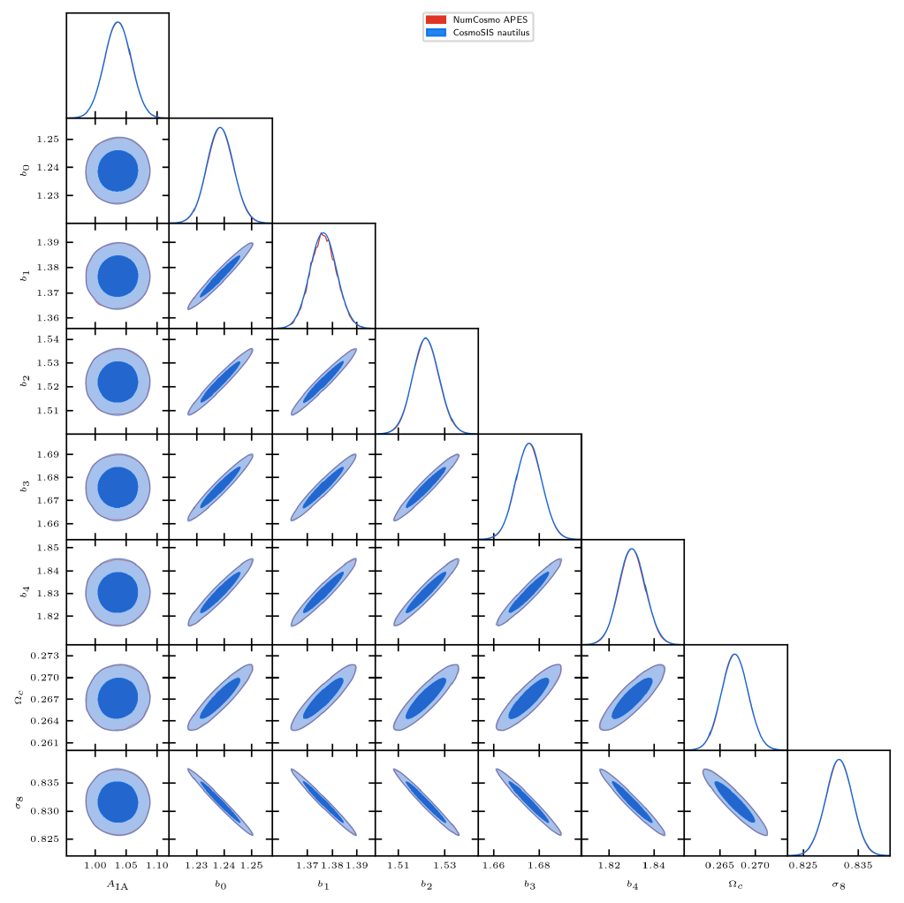

# Sampler results on the 3x2pt forecast

The likelihood of this forecast (README.md) was sampled with NumCosmo APES and CosmoSIS
nautilus, each used with its defaults, on the noisy data vector with the 8 free
parameters and uniform priors of `generate_configs.py`. Cobaya `mcmc` has no converged
run yet (see "Cobaya" below). The runs used Firecrown 1.16.2, NumCosmo 0.30.0
(`mpi_openmpi` build), CosmoSIS 3.27.1 and Cobaya 3.6.2 on one 12-core desktop (AMD Ryzen 9
9900X), with 12 MPI processes and one OpenMP thread per process. One likelihood
evaluation takes 0.95 s on one thread.

## Main points

* APES and nautilus give the same posterior. The means of all 8 parameters differ by at
  most 0.3 standard errors of the mean, and the corner plots coincide.
* APES reached an effective sample size of about 20 000 with 90 000 likelihood
  evaluations in 2 h 17 min; nautilus reached 20 000 with 156 600 evaluations in
  4 h 10 min.
* nautilus cannot stop before its exploration phase ends. Here exploration alone gave an
  effective sample size of 19 996, ten times the `n_eff = 2000` requested.
* The nautilus standard deviations are 0.8% to 1.4% larger than the APES ones for the 7
  parameters of the correlated block (lens biases, Ω_c, σ8) and 0.3% smaller for
  `ia_bias`. The statistical error of a standard deviation at an effective sample size
  of 20 000 is about 0.5%.
* The evidences differ by 0.026 in ln Z. This difference is not explained yet.
* Cobaya `mcmc` with its initial proposal from `generate_configs.py` (diagonal, 1% of
  each fiducial value) stopped after 1 h with about 2.4% acceptance.

## APES and nautilus



The nautilus contours (blue) cover the APES contours (red).

| | NumCosmo APES | CosmoSIS nautilus |
|---|---|---|
| settings | 900 walkers (the default 100 (d + 1), d = 8), 100 iterations | 2000 live points, `discard_exploration = F`, `f_live = 0.01` |
| likelihood evaluations | 90 000 | 156 600 |
| wall time, 12 processes | 2 h 17 min | 4 h 10 min |
| burn-in | 18 iterations | none |
| effective sample size | 19 765 to 27 081 (per parameter) | 19 996 |
| ln Z, normalized priors | -313.659 ± 0.003 | -313.685 |

| parameter | fiducial | APES mean ± σ | nautilus mean ± σ |
|---|---|---|---|
| Ω_c | 0.26643 | 0.26714 ± 0.00185 | 0.26714 ± 0.00187 |
| σ8 | 0.83100 | 0.83154 ± 0.00239 | 0.83154 ± 0.00242 |
| `ia_bias` | 1 | 1.03673 ± 0.02124 | 1.03673 ± 0.02118 |
| `lens0_bias` | 1.23886 | 1.23870 ± 0.00477 | 1.23870 ± 0.00483 |
| `lens1_bias` | 1.37810 | 1.37651 ± 0.00534 | 1.37653 ± 0.00539 |
| `lens2_bias` | 1.52472 | 1.52197 ± 0.00563 | 1.52198 ± 0.00571 |
| `lens3_bias` | 1.67666 | 1.67565 ± 0.00580 | 1.67565 ± 0.00586 |
| `lens4_bias` | 1.83243 | 1.83034 ± 0.00589 | 1.83036 ± 0.00596 |

The amplitude σ8 is anti-correlated with every lens bias (-97% to -98%) and with Ω_c (-93%);
`ia_bias` is correlated with no parameter by more than 6%.

### APES

The burn-in of 18 iterations is the one `numcosmo catalog analyze` suggests (constant
break point; Heidelberger-Welch suggests 17). After it, 82 iterations remain, the
Gelman-Rubin R - 1 is at most 0.008 for every parameter, and the variance of -2 ln L over
the samples is 15.8 (16 for a Gaussian posterior in 8 dimensions).

The effective sample size of each parameter is the NumCosmo catalog estimate
$$
n_{\rm eff} = \frac{K_{\rm eff}\, n_{\rm iter}}{\tau},
$$
where $\tau$ is the autocorrelation time of the per-iteration mean over the walkers (2.3
to 3.2 iterations), $n_{\rm iter} = 82$ is the number of iterations after burn-in, and
$K_{\rm eff}$ is the variance of one walker divided by the variance of the per-iteration
mean (684 to 851 of the 900 walkers). Each chain is shorter than $50\tau$, the length at
which NumCosmo considers $\tau$ accurately measured, so the effective sample sizes are
approximate.

### nautilus

The nautilus sampler first explores the posterior, adding shells of increasing likelihood until the
live set holds less than the fraction `f_live` of the evidence. Only then can it stop on
`n_eff`. Its effective sample size is $(\sum_i w_i)^2 / \sum_i w_i^2$, where $w_i$ is the
weight of output point $i$; it does not depend on an autocorrelation time, since the
points are independent weighted draws.

The nautilus samples are written as a weighted NumCosmo catalog by
`nautilus_to_catalog.py`, so that `numcosmo catalog plot-corner` draws both runs. NumCosmo
0.30 computes no autocorrelation time for a weighted catalog, so `numcosmo catalog
analyze` does not run on it and `plot-corner` needs `--thin 1`.

### Evidence

NumCosmo's catalog evidence is for a uniform prior of unit density on the parameter box;
subtracting the log of the box volume, ln V = 3.93408, gives the evidence for the
normalized uniform priors that nautilus uses. CosmoSIS reports the nautilus ln Z error as
$1/\sqrt{n_{\rm eff}} = 0.007$, which is not an error measured by nautilus, so the
difference of 0.026 cannot yet be expressed in standard deviations.

## Cobaya

Cobaya `mcmc`, 12 chains under MPI, started from the `ref` distributions and proposal
widths written by `generate_configs.py` (both 1% of each fiducial value, 1.5 to 3.5 times
the posterior widths) without an initial covariance. Acceptance was about 2.4% over the
first 31 min. After 1 h one chain had rejected 320 consecutive proposals (Cobaya's
`max_tries`, 40 d) and Cobaya stopped the run before its first Gelman-Rubin check. A run
started with the APES covariance (`apes_covmat.py`) reaches 30% acceptance, but uses
information from another sampler.

## Reproducing

```bash
NPROC=12 NWALKERS=900 NSAMPLES=100 SEED=1 ./run_apes.sh
numcosmo catalog analyze numcosmo/apes.mcmc.fits --burnin 18 --evidence
NPROC=12 NLIVE=2000 NEFF=2000 ./run_nautilus.sh
python nautilus_to_catalog.py
numcosmo catalog plot-corner numcosmo/apes.mcmc.fits cosmosis/output/nautilus.mcmc.fits \
    --burnin 18 --thin 1 --plot-name "NumCosmo APES" --plot-name "CosmoSIS nautilus" \
    --no-show --output numcosmo/apes_nautilus
```

The option `--burnin` applies to both catalogs; the first 18 nautilus points have zero weight.
