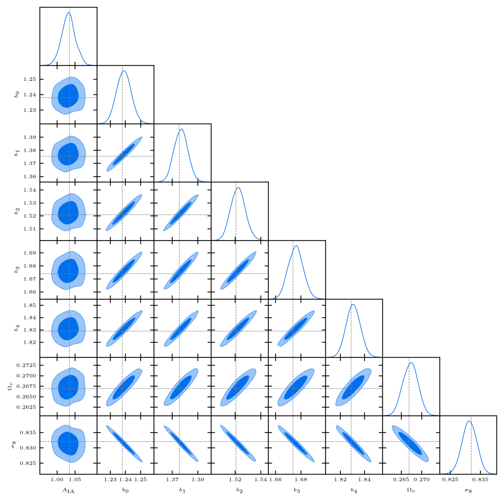

# Firecrown

## What Firecrown Is

Firecrown is a **likelihood framework**: a DESC likelihood is written **once** and run under **any**
of the supported statistical frameworks.

It computes the prediction with **CCL**, reads data and covariance from **SACC**, and evaluates the
likelihood; the sampler calls it through a Firecrown **connector**. Firecrown does **not** sample:
the framework does.

:::: {.columns}

::: {.column width="45%"}
**Supported frameworks**

- Cobaya
- CosmoSIS
- NumCosmo
:::

::: {.column width="55%"}
**Probes available**

- 3×2pt: clustering, galaxy-galaxy lensing, cosmic shear
- CMB cross-correlations
- Supernovae
- Cluster counts and cluster lensing
:::

::::

Tutorial: [Introduction](https://firecrown.readthedocs.io/en/latest/_static/intro_article.html) ·
[Installation](https://firecrown.readthedocs.io/en/latest/non_developer_installation.html)

## The Tool Chain

The measurement and the theory meet in Firecrown, and each sampler calls the result:
$$
\text{TXPipe} \longrightarrow \text{SACC} \longrightarrow \textbf{Firecrown} \longleftarrow \text{CCL},
\qquad
\textbf{Firecrown} \longrightarrow \{\text{Cobaya},\ \text{CosmoSIS},\ \text{NumCosmo}\}.
$$
- **SACC** holds the measurement: tracers, $\mathrm{d}N/\mathrm{d}z$, data vector, covariance,
  bandpower windows.
- **CCL** computes the theory: distances, $P(k)$, angular power spectra.
- **Firecrown** computes the likelihood from both; each sampler calls it through a connector.

## Three Concepts

- **Cosmology**: `pyccl.Cosmology`, a parameterized model computed by CCL.
- **Modeling tools**: `firecrown.modeling_tools.ModelingTools` holds the cosmology together with the
  other models a likelihood needs (for example a perturbation-theory calculator), so every part of
  the likelihood uses the same calculation for the current parameters.
- **Likelihood**: `firecrown.likelihood.Likelihood`
  - `read(sacc_data)`: reads the data vector and covariance
  - `compute_loglike(tools) -> float`: $\ln L$ for the current parameters

Gaussian-family likelihoods (`ConstGaussian`, `StudentT`) evaluate
$$
\chi^2 = \sum_{i,j} (x_i - \mu_i)\, (C^{-1})_{ij}\, (x_j - \mu_j)
$$
from the data vector $x$ and covariance $C$ (read from SACC) and the theory vector $\mu$ (computed by
the statistics).

Tutorial: [An Introduction to Firecrown](https://firecrown.readthedocs.io/en/latest/_static/introduction_to_firecrown.html)

## Building Blocks for Two-Point Statistics

- **Statistic**: provides the data vector and computes the theory vector.
  - `TwoPoint`: the correlation of two `Source`s; the same source twice gives an autocorrelation.
- **Source**: a tracer of the matter field (`NumberCounts`, `WeakLensing`), built from the
  $\mathrm{d}N/\mathrm{d}z$ in the SACC file.
- **Systematic**: modifies how a source is computed.
  - lenses: `LinearBiasSystematic`, `ConstantMagnificationBiasSystematic`, `PhotoZShift`
  - sources: `LinearAlignmentSystematic`, `PhotoZShift`, `MultiplicativeShearBias`

Each systematic adds sampled parameters named after its tracer: `lens0_bias`, `src2_delta_z`,
`ia_bias`, ...

Tutorial: [Two-point framework](https://firecrown.readthedocs.io/en/latest/_static/two_point_framework.html) ·
[Systematics](https://firecrown.readthedocs.io/en/latest/_static/systematics.html) ·
[SACC data](https://firecrown.readthedocs.io/en/latest/_static/two_point_sacc_data.html)

## The Factory and One Evaluation

A likelihood is defined by a **factory function**: every framework calls the same one.

```python
def build_likelihood(params: NamedParameters) -> tuple[Likelihood, ModelingTools]:
    sacc_data = load_sacc_data(params.get_string("sacc_file"))
    ...  # sources, systematics, TwoPoint statistics
    likelihood = ConstGaussian(statistics=statistics)
    likelihood.read(sacc_data)
    return likelihood, ModelingTools(...)
```

For each set of parameters, the connector runs one cycle:

```python
tools.update(params)       # new parameter values
tools.prepare()            # CCL cosmology for these parameters
likelihood.update(params)
loglike = likelihood.compute_loglike(tools)
likelihood.reset()
tools.reset()              # ready for the next point
```

Tutorial: [Development example](https://firecrown.readthedocs.io/en/latest/_static/development_example.html) ·
[Two-point factory basics](https://firecrown.readthedocs.io/en/latest/_static/two_point_factory_basics.html)

## Examples and Generated Analyses

Firecrown ships runnable examples. Each one writes the data, the likelihood factory and the
configuration for the chosen framework:

```bash
$ firecrown examples                     # cosmic_shear, cmb_cross, sn_srd, des_y1_3x2pt
$ firecrown examples des_y1_3x2pt des --target-framework cosmosis
$ firecrown examples des_y1_3x2pt des --target-framework cobaya
$ firecrown examples des_y1_3x2pt des --target-framework numcosmo
```

The command line is generated from a `dataclass`, so the same generation runs from Python:

```python
from firecrown.app.analysis import AnalysisBuilder, Frameworks
```

`AnalysisBuilder` is what this tutorial's repository uses to write its three configurations.

Tutorial: [Two-point workflow](https://firecrown.readthedocs.io/en/latest/_static/two_point_workflow.html)

## One Likelihood, Three Frameworks

```bash
$ cosmosis   cosmosis_des_y1_3x2pt.ini
$ cobaya-run cobaya_des_y1_3x2pt.yaml
$ numcosmo   run test numcosmo_des_y1_3x2pt.yaml
```

Three samplers, three parameter conventions, three configuration formats, and **one** factory file.

The likelihood is not rewritten when the inference tool changes.

# Today's Forecast

## A 3×2pt Forecast for LSST Y1

Repository: `firecrown_3x2pt_forecast` (see its `README.md`)

:::: {.columns}

::: {.column width="50%"}
**Data**

- 5 lens bins, 5 source bins
- 27 spectra: 5 clustering autospectra, 7 galaxy-galaxy lensing, 15 cosmic shear
- 20 top-hat bandpowers, $20 \le \ell \le 2000$
- 540 data points, total $S/N = 1541$
:::

::: {.column width="50%"}
**Fiducial point**

| parameter | value |
|---|---|
| $\Omega_c$, $\Omega_b$, $h$ | 0.2664, 0.0492, 0.6727 |
| $n_s$, $\sigma_8$ | 0.9645, 0.831 |
| lens bias $b_i$ | $1.05/D(\bar z_i)$: 1.24 … 1.83 |
| `ia_bias` | 1 |
| photo-z shifts, $s_{\rm mag}$ | 0 |
:::

::::

The cosmology and lens bias follow the LSST DESC SRD Y1 setup; magnification and the intrinsic
alignment amplitude are choices of this forecast.

## The Likelihood Factory: `forecast_3x2pt.py`

```python
lenses = [
    nc.NumberCounts(sacc_tracer=f"lens{i}", has_rsd=True, systematics=[
        nc.PhotoZShift(sacc_tracer=f"lens{i}"),
        nc.ConstantMagnificationBiasSystematic(sacc_tracer=f"lens{i}"),
        nc.LinearBiasSystematic(sacc_tracer=f"lens{i}")])
    for i in range(5)]
ia_systematic = wl.LinearAlignmentSystematic()
sources = [wl.WeakLensing(sacc_tracer=f"src{i}",
                          systematics=[wl.PhotoZShift(sacc_tracer=f"src{i}"), ia_systematic])
           for i in range(5)]
statistics = [TwoPoint(source0=lenses[i], source1=lenses[i], sacc_data_type="galaxy_density_cl") ...]
likelihood = ConstGaussian(statistics=statistics)
likelihood.read(sacc_data)
tools = ModelingTools(ccl_factory=CCLFactory(
    amplitude_parameter=PoweSpecAmplitudeParameter.SIGMA8,
    creation_mode=CCLCreationMode.PURE_CCL_MODE,
    pure_ccl_transfer_function=CCLPureModeTransferFunction.EISENSTEIN_HU))
```

**Pure CCL mode**: CCL computes the cosmology (Eisenstein-Hu and halofit) inside the likelihood, so
CosmoSIS, Cobaya and NumCosmo evaluate the same theory.

## Data and Covariance: `generate_data.py`

**Mean**: the theory vector at the fiducial point, `likelihood.make_realization(sacc, add_noise=False)`.
**Noisy data**: the mean plus $L z$, with $C = L L^T$ and $z$ standard normal (`add_noise=True`).

**Covariance**: Gaussian, bandpowers on a fraction $f_{\rm sky}$ of the sky,
$$
\mathrm{Cov}\left[C^{ab}_L, C^{cd}_{L'}\right] = \sum_\ell \frac{w_L(\ell)\, w_{L'}(\ell)}{(2\ell+1) f_{\rm sky}} \left[\tilde C^{ac}_\ell \tilde C^{bd}_\ell + \tilde C^{ad}_\ell \tilde C^{bc}_\ell\right],
$$
with $\tilde C^{ab}_\ell \equiv C^{ab}_\ell + N^{ab}$ and the LSST DESC SRD Y1 noise:

| $f_{\rm sky}$ | lens $\bar n_i$ [arcmin$^{-2}$] | source $\bar n_i$ [arcmin$^{-2}$] | $\sigma_e$ |
|---|---|---|---|
| 0.3 | 2.40, 3.82, 4.29, 4.05, 3.44 | 2.0 each | 0.26 |

## Configurations: `generate_configs.py`

`generate_configs.py` subclasses Firecrown's `AnalysisBuilder` and writes the three configurations,
with `FrameworkCosmology.NONE` (the cosmology comes from CCL inside the likelihood) and 8 free
parameters: $\Omega_c$, $\sigma_8$, `ia_bias`, `lens0_bias` … `lens4_bias`.

`run_test.sh` evaluates the likelihood once in each framework:

| data | CosmoSIS $-2\ln L$ | Cobaya $-2\ln L$ | NumCosmo $-2\ln L$ |
|---|---|---|---|
| noiseless | 0 | 0 | 0 |
| noisy | 539.0838 | 539.084 | 539.0838 |

540 data points: the noisy data vector has $\chi^2 = 539.08$ at the fiducial point.

## APES under MPI: `run_apes.sh`

:::: {.columns}

::: {.column width="45%"}
{fig-alt="Corner plot of the APES chain: ia_bias, five lens biases, Omega_c and sigma8."}
:::

::: {.column width="55%"}
NumCosmo APES, 11 MPI processes, 900 walkers, 21 iterations (2 h 10 min).

Burn-in: 12 iterations, where the ensemble variance of $-2\ln L$ stops decreasing.

| quantity | value |
|---|---|
| $R - 1$ (parameters) | 0.04 to 0.06 |
| $\mathrm{Var}(-2\ln L)$ | 15.2 (16 for a Gaussian in 8 dimensions) |
| $\Omega_c$ | $0.2673 \pm 0.0018$ (fiducial 0.2664) |
| $\sigma_8$ | $0.8313 \pm 0.0024$ (fiducial 0.831) |

$\sigma_8$ is anti-correlated with every lens bias ($-55\%$ to $-62\%$). Combining clustering,
galaxy-galaxy lensing and shear constrains both.
:::

::::

## Cobaya with the APES Covariance: `run_cobaya.sh`

Cobaya `mcmc`, 10 chains under MPI, stopping at $R - 1 < 0.01$.

| initial proposal | acceptance |
|---|---|
| diagonal, 1% of each fiducial value | 2.8% (one chain, 720 steps) |
| APES posterior covariance (`apes_covmat.py`) | 30% to 50% (10 chains, first 40 to 61 steps) |

The 1% widths are 1.5 to 3.5 times the posterior widths, and the posterior is strongly correlated, so
most steps of a diagonal proposal of that size are rejected. With the covariance measured by APES,
Cobaya proposes steps with the posterior's shape from the start.

## Run It Yourself

```bash
python generate_data.py          # data vectors and covariance (about 15 s)
python generate_configs.py       # CosmoSIS, Cobaya and NumCosmo configurations
./run_test.sh                    # one evaluation in each framework
./run_apes.sh                    # NumCosmo APES with MPI (needs the mpi_openmpi build)
python numcosmo_catalog.py plot-corner numcosmo/apes.mcmc.fits --burnin 12 --no-show --output numcosmo/apes
python apes_covmat.py && ./run_cobaya.sh   # Cobaya mcmc with the APES covariance
```

Tutorial: [Firecrown tutorials](https://firecrown.readthedocs.io/en/latest/_static/index.html) ·
[Documentation](https://firecrown.readthedocs.io/en/latest/)
